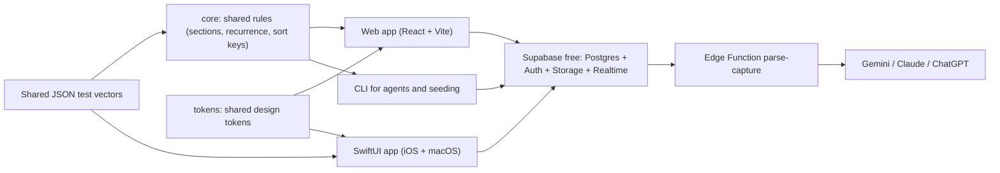

# TaskMan plan

TaskMan is a working name. A single-user task manager for web, iOS and macOS, modeled loosely on TickTick, built around one board that orders tasks by whether they can be started.

## Product rules

### The board

One view to start. Sections, top to bottom:

| Section | A task is here when |
|---|---|
| In Progress | status is `in_progress` |
| Waiting | status is `waiting`. Tasks needing follow-up are visible; tasks still within their hide-until period are tucked behind a "Show N hidden until later" row inside the section |
| Ready | status is `open` and the start date is empty, today, or in the past |
| Upcoming | status is `open` and the start date is after today. **Collapsed by default** |

Every collapsible part remembers whether you last left it expanded.

### Waiting

Waiting is a **status**, on the same picker as In Progress, because a task can't be both. Waiting counts as in progress: **only Open tasks have a start date**, and Waiting has its own date, **hide until**. A typical flow: you've made progress, and now someone else has to act before you can finish.

- **Going in:** choose Waiting from the status menu, the **Move to Waiting** row action, or drag into the Waiting section. Every way in opens the same picker, **Hide until**, with quick picks: **Tomorrow, Saturday** (the coming one; hidden on Fridays, when it would repeat Tomorrow), **1 week, Pick date, Don't hide**. **Don't hide** is the highlighted default (the task needs follow-up now). The dialog title is "Hide until", with no subheading and no body text; the task name stays available to screen readers. Pick date can't choose a past day. There is no "waiting on" field: the title says who. The picked date is stored as the task's **hide-until date** (`hide_until`), a field of its own that only Waiting tasks have. It may fall after the due date, and picks aren't capped by it. Going into Waiting clears any start date. Only Waiting tasks offer **Hide until** as a row action (`extendWait` and `checkBack`, both labeled Hide until, with a closed-eye icon); Ready and In Progress offer **Move to Waiting** (`moveToWaiting`, hourglass) instead, which opens this picker.
- **Two sub-states inside the one Waiting section:**
  - **Needs follow-up (visible):** no hide-until date, or the hide-until date is today or earlier, or the due date is today or earlier. There's no badge: being in the visible part of Waiting says it.
  - **Hidden until later (tucked away):** the hide-until date is in the future. These tasks sit behind a "Show 3 hidden until later" row at the bottom of the section, collapsed by default, each showing its hide-until date with an hourglass ("Nov 21").
  - The section header counts both. If every waiting task is tucked away, the section shows just its header and the "Show N" row.
- **Acting on a task that needs follow-up:** two actions, plus the checkbox, which completes it as usual:
  - **Hide until:** the same picks, counted from today, for when you nudged the person and need more time.
  - **Move to In Progress:** the blocker cleared, so the task goes to In Progress and its hide-until date is cleared. It never asks.
  - On desktop they are icon-only buttons at the end of the row. Phone rows don't show them (the targets would be too small); they're in the swipe actions and the task sheet, which labels them.
- Completing a recurring Waiting task ends the wait: the next occurrence is `open`, with its hide-until date cleared, its start date recomputed and its subtasks reset.
- **Status changes never ask about dates.** Each change clears the dates that no longer apply, silently and with no toast:
  - **Going into Waiting or In Progress** clears the start date. Waiting's own hide-until date comes from the Hide until picker, which always opens on the way into Waiting.
  - **Leaving Waiting** (Move to In Progress, the status menu, or dragging to Ready or In Progress) clears the hide-until date, so a task going to Ready is Ready right away, not Upcoming.
  - Only an Open task can be in Upcoming.
  - `core`'s `changeStatus(task, to, today)` decides this for every client and returns the task. It has no decision step, no `choice` argument and no policy defaults. Non-interactive callers (CLI commands, AI capture, sync) call it the same way, so the CLI's `status`, `act` and `move` never exit with code 2 for a date question.
- The hide-until date is its own field, `hideUntil` (`hide_until`), and only Waiting tasks have it. Which sub-state a task is in is derived, never stored, like the sections.
- In Phase 5, the hide-until date can also send a notification.

Not on the board by default: completed tasks (a "Show completed" toggle in the menu adds a collapsed Completed section at the bottom) and deleted tasks (a Trash screen in the menu).

- The section is **derived, never stored**. One shared function, `sectionFor(task, today)`, decides it, so the web app, the native apps and the CLI can never disagree.
- A Waiting task is always in Waiting: its future hide-until date only tucks it under "hidden until later." Only an Open task has a start date, so only an Open task can be in Upcoming. Moving an Upcoming task into In Progress is "Start now" and clears its start date.
- "Today" is the device's local calendar day. Tasks move from Upcoming to Ready when the day rolls over, with no background job.
- Start and due dates are **days only** (Postgres `date`), with no times or time zones.
- The due date is informational: shown in the row, red when overdue. Later on it will set the default for reminders.

### Ordering and drag-and-drop

- You can drag to reorder within a section. Dragging between In Progress, Waiting and Ready changes the status. Dropping into Waiting opens the Hide until picker. Dropping into Upcoming opens the start-date picker (Tomorrow, +1 week, +2 weeks, Pick date, from tomorrow and never after the due date; a Waiting or In Progress task becomes Open, and its hide-until date is cleared without asking). A task due today or earlier can't start later, so that drop, and only that drop, asks: **Remove due date** clears the due date and goes on to the start-date picker, and **Cancel** leaves the task where it started (core's `planUpcomingDrop` returns this as a decision, like `changeStatus`; the CLI's `move --upcoming --start <date>` exits with code 2 unless `--clear-due` answers it). Dropping onto a collapsed section isn't allowed. Empty In Progress, Waiting and Ready sections stay hidden, and appear as drop targets only while dragging.
- **Dragging starts at a handle.** Every draggable row has a small handle column left of the checkbox (`DotsSixVertical`, the muted checkbox-ring color until hovered and then blue, per guideline 15, grab cursor). With a mouse the grip shows only while the row is hovered, while the handle has keyboard focus, and while the row is dragged (its column stays reserved, so titles don't shift); on screens with no hover, such as phones, it is always visible. A drag starts only when you press (touch: press and hold) on it. Keyboard users focus the handle and press Space. Rows that can't be dragged (Completed, Trash, offline) leave the column empty so titles line up, and section titles line up with them.
- **A dropped row settles into its new place.** The board updates in the same tick as the drop (the cache change reaches React synchronously), so the drag overlay slides to the row's new position and never back to the old one.
- **After a drop, the row is highlighted for 2 seconds, then the highlight fades out** (with reduced motion it just ends). It shows once the move has been saved, including a drop that first needed a Hide until or start-date answer.
- Order is stored **per view**: a `task_positions(view_id, task_id, sort_key)` table with fractional-index string keys, so one move writes one row. The board is `view_id = 'main'`, and future filtered views get their own order for free.
- New tasks go to the top of Ready (or of the section they land in).
- **Tasks arriving on their own go to the bottom of Ready.** That covers a start date arriving, and the next occurrence of a recurring task when it has no start date or its start date is today or earlier. A next occurrence with a future start date goes to Upcoming instead.
- How that works without a background job: a task with a future start date has no stored position, and Upcoming is sorted by start date (soonest first). A task in Ready with no stored position sorts below all positioned tasks, by start date (empty last), then creation time, then id, so the order is always the same on every device. It gets a real position the first time you drag it. Completing a recurring occurrence and setting a future start date both clear the stored position.

- **Completing animates.** A checked-off task stays in its list for 500ms with its title struck through, then folds away (height and fade, 200ms) while it grows into the top of Completed if that section is open. Un-completing is the same in reverse: the row stays in Completed without its strikethrough, folds away and grows back into its section. The write is never held back: the board data changes at the click, and the animation only changes how the list shows it (a stand-in "ghost" row holds the old place). Toggling the row again, going offline or reduced motion skips the animation. Checking off also gives a 10ms `navigator.vibrate` pulse where the browser has it (not iOS Safari; real haptics come with the SwiftUI app).
- **Deleting animates.** The row collapses and fades while the rows below slide up into the gap, then the delete is saved (at once with reduced motion or offline). Deleting the last task in a section takes the section's heading and gap with it. It's the same 200ms ease-out as the section fold. Undo brings the row back without animating.

### Row actions (swipe, and right-click on desktop)

One shared function in `core`, `actionsFor(task, today)`, picks the actions from the task's state, so phone swipes, the desktop right-click menu and hover buttons always match.

- **Swipe right:** reveals the **Flag** toggle, and that's all. There's no full-swipe complete; completing is the checkbox.
- **Swipe left:** reveals a **date** button (orange), a **state** button (blue; a follow-up gets two, Hide until and Move to In Progress), and **Delete** (red).
- Swipe buttons are icon-only, with no labels: small colored rounded buttons sitting inside the row, not full-height colored panels. There's no "Move to," since there's only one list. The date and state buttons open a small grid of presets, like TickTick's date popover. The tiles show only an icon and a label, with no date underneath.

| Task is in | Date button presets | State button | 
|---|---|---|
| Ready | Due: Today, Tomorrow, Next Monday, Pick date, No due date | **Move to Waiting** (opens the Hide until picker) |
| In Progress | Due: same as Ready | **Move to Waiting** |
| Waiting, needs follow-up | Due: same as Ready | **Hide until** (Tomorrow, Saturday, 1 week, Pick date, Don't hide), **Move to In Progress** |
| Hidden until later | Hide until: Tomorrow, +3 days, +1 week, Pick date, **Now** (makes it need follow-up) | **Move to In Progress** |
| Upcoming | Start: **Start today** (moves it to Ready), +1 week, Next month, Pick date, No start date | **Start now** (In Progress) |
| Completed (when shown) | none | **Mark not done** |
| Trash | none | **Restore** (Delete becomes **Delete forever**) |

- A recurring task adds **Skip this occurrence** to its date presets.
- A task due after today adds **+1 day** (a day after its due date) as the first due preset. It's left out when the task is due today or overdue, where it would equal Tomorrow, so a due date never moves to another past day.
- When a task's state changes the presets, the button's icon changes too (calendar, closed eye for hide until, sunrise for start), so you can tell what it will do before tapping.
- These come with Phase 1a (swipe in mobile Safari, right-click and hover on desktop) and carry over to the native apps in Phase 3.

### Task fields

- **Title:** the only text shown in the list row. On wide screens it edits in place, and while you type the open detail pane shows the same text (Escape restores both).
- **Description:** stored as Markdown text. The editor auto-formats lists: typing `- `, `* ` or `1. ` at the start of a line makes a list, Enter continues it, Enter on an empty item ends it, and Tab or Shift+Tab indents. The list row doesn't mark tasks that have a description.
- **Start date, hide until, due date:** optional, blank by default. The start date is only for Open tasks and hide until only for Waiting tasks, so the sheet shows Start and Due for Open, Hide until and Due for Waiting, and Due only for In Progress.
- **Flag:** a single on/off toggle for priority or "keep an eye on this," off by default. It's the flag button in the task sheet's header (as in TickTick) and a swipe action. A flagged row shows an orange flag. Flagging doesn't move a task; order stays manual. Search can filter to flagged tasks, and a future saved view could show only flagged ones. Completing a recurring occurrence keeps the flag.
- **Status:** open, in progress or waiting, plus completed and deleted timestamps.
- **Tags** (phase 2): many-to-many, used by search and future filtered views.
- **Subtasks** (phase 2): title and done flag, ordered, and they exist only inside their parent task.
- **Repeat rule** (phase 2), **attachments** (phase 4), **reminders** (phase 5).

### Recurrence

Each recurring task is **one task with a repeat rule**, never a list of pre-generated copies, so only one occurrence is ever visible.

It supports all three of TickTick's repeat types:

| Type (TickTick name) | `mode` | Next due date after completing |
|---|---|---|
| By Due Dates | `schedule` | The first rule date after the old due date that is today or later. A missed occurrence catches up to the present instead of piling up |
| By Completion Date | `after_completion` | The completion day plus the interval (every N days, weeks, months or years) |
| By Specific Dates | `dates` | The next date in a hand-picked list that is after the old due date and today or later. When the list runs out, the repeat ends and completing works like a normal task |

```
repeat = {
  mode: schedule | after_completion | dates,
  freq: daily | weekly | monthly | yearly,       // schedule, after_completion
  interval: 1..n,                                 // "every N"
  byWeekday?: [mon..sun],                         // weekly: one or more days; "Every Weekday" = mon-fri
  monthly?: { day: 1..31 | -1 }                   // the 14th, or the last day
          | { nth: 1..4 | -1, weekday }           // the 2nd Tuesday, the last Friday
  dates?: [date, ...],                            // dates mode only
  ends?: { never } | { onDate } | { afterCount }, // TickTick's "Ends" option
  startOffsetDays?: 0..n                          // works with all three modes
}
```

- After-completion mode only uses `freq` and `interval`, like TickTick, because a weekday rule doesn't make sense counting from the completion day.
- The date math is a small hand-written engine in `core`, ported to Swift, and both are driven by the same test vectors. Off-the-shelf RRULE libraries don't cover catch-up, after-completion or specific-dates mode, and there's no good Swift one. Schedule mode's fields still line up with RRULE, so calendar exports stay possible.
- **Month ends clamp:** "monthly on the 31st" lands on the 30th or the 28th/29th in short months (TickTick's behavior, not RRULE's skip). The same clamp applies to `+1m` in the CLI and seed dates.
- A repeat needs a due date to anchor to. If none is set, choosing a repeat sets the due date to today, or to the first listed date in `dates` mode.
- `startOffsetDays` keeps the start date N days before each due date. So "garbage, weekly on Monday, visible 1 day early" sits in Upcoming until Sunday. **No offset means no start date** (the task is Ready as soon as the occurrence begins); an offset of 0 means the start date equals the due date.
- Editing the due date by hand re-anchors the series from the new date. Editing the rule applies from the current due date onward. Past completions are never rewritten.
- Skip consumes an occurrence: it counts toward `ends.afterCount`.
- "The day it was completed" is the **local calendar day** on the device, stored as `completed_on date` beside the timestamp, so completing at 11pm or while travelling doesn't shift the next due date.
- The repeat picker mirrors TickTick's: presets (Daily, Weekly on that weekday, Monthly on that date, Yearly, Every Weekday), then Custom with a Repeat Type menu for the three modes, plus Ends and the start offset.
- The task sheet has a **Skip this occurrence** action, which advances the dates without recording a completion.
- **Completing an occurrence** adds a row to `task_completions` (history), then in one transaction:
  - The due date advances using the table above.
  - The start date becomes the new due date minus the offset (or empty with no offset), subtasks reset to not done, the status goes back to `open` and the stored board position clears. The flag stays.
  - If `ends` is reached, the task is completed for good instead.
- Undo restores the previous dates and subtasks from the completion row. It's offered by the toast, and afterwards by `undone`/Mark not done only while the task hasn't been edited since that completion.
- Deleting a recurring task deletes the whole series.

### Free-form capture (AI)

Speak or type a rambling note, and the app turns it into one or more proposed tasks for you to review before anything is saved.

**Flow**
1. **Capture:** a "Capture" button beside the + button (and a mode in quick add) opens a large text box. You dictate with the keyboard's microphone (works in the installed web app and natively, no audio leaves the device for this step), type, or paste. For example: *"Call the dentist tomorrow, I'm waiting on Alex for the deck quote, check back Friday, and every other Sunday water the plants. Oh and file taxes, start thinking about it in February, due April 15."*
2. **Parse:** the text goes to an AI model, which returns structured tasks.
3. **Review:** a sheet lists each proposed task as a card: title, plus chips for every field it filled in (due Thu Nov 19, Waiting · hide until Fri, repeats every 2 weeks on Sunday, start Feb 1, flag, tags, subtasks). You can tap a card to open it in the normal task sheet, untick tasks you don't want, or edit chips. The original text stays visible at the top. **Add 4 tasks** saves them; Cancel saves nothing.
4. Saved tasks land like any new task (top of their section, or Upcoming if they have a future start date).

**What the model is told:** today's date and weekday, your time zone, your existing tag names (so it reuses them rather than inventing near-duplicates), and the app's rules in plain terms: start date means the day an Open task becomes ready, hide until is a Waiting task's own date, due date is the deadline, "waiting on someone" means Waiting status, and the three repeat types. It must answer with JSON matching a fixed schema:

```
{ tasks: [ { title, description?, startDate?, hideUntil?, dueDate?, status: open|in_progress|waiting,
             flagged?, tags?: [..], subtasks?: [..], repeat?: {...same shape as tasks.repeat} } ],
  notes?: "anything it couldn't place, shown at the top of the review sheet" }
```

- Every proposed task is checked by `core` before the review sheet shows it (real dates, a valid repeat rule, known status). An invalid field is dropped and marked on its card rather than failing the whole capture.
- If the AI call fails or isn't set up, each line of the text becomes a plain task title in the same review sheet, so capture always works.

**Providers and keys**
- Gemini, Claude and ChatGPT are all supported behind one small interface, chosen in Settings. Each provider's structured-output feature (JSON schema) forces the reply into the schema above.
- API keys never reach the browser or the phone. A **Supabase Edge Function** (`parse-capture`) holds them as secrets and makes the call. Edge Functions are on the free plan (500,000 calls a month).
- **Key safety:**
  - Keys are set with `supabase secrets set` and only ever exist as environment variables inside the function. They're never in git, the database, or any `VITE_` variable (those are bundled into the public web app).
  - The function requires a signed-in user (JWT check on, the default), caps input size, and limits itself to a few calls a minute, so a stranger can't spend your quota.
  - It never logs keys or request headers.
  - Use a dedicated key per provider for this app only, with a monthly spend cap set on the provider's side.
  - Turn on two-factor sign-in for the Supabase and GitHub accounts, since dashboard access is what could expose the secrets.
- **Cost:** Gemini's Flash models have a free tier, which can cover personal use at $0; the trade-off is that Google may use free-tier prompts to improve its models. On any paid tier (Gemini, Claude Haiku or GPT mini models), one capture costs a small fraction of a cent.
- Settings shows a one-line notice that captured text is sent to the chosen provider.
- The last 50 captures (text, model reply, and what you actually saved) are kept in `capture_log` so the prompt can be improved against real examples. Clearable in Settings.

**Testing without paying**
- `seed/capture-examples.json` holds example utterances with the tasks they should produce, at a pinned date.
- CI never calls a real model: it replays recorded replies through validation and the review-sheet logic.
- `cli capture "text" [--today ...] [--provider gemini]` prints the proposed tasks as JSON without saving; `--apply` saves them. `cli capture-eval` runs every example against a real provider on demand and scores the results, for checking prompt changes.

### Search, completed tasks, trash

- Search covers titles and descriptions (Postgres full-text search plus a trigram fallback for partial words), and covers tags from phase 2. By default it searches open tasks, with a toggle to include completed ones. It never includes Trash.
- Completed tasks are never deleted automatically. The Completed section is sorted newest first.
- Delete is soft (`deleted_at`). The Trash screen offers Restore and Delete Forever. A daily `pg_cron` job permanently removes anything whose deletion day is **more than 30 days** before today (deleted 30 days ago stays; 31 goes), with the CLI's `purge-trash` as the same code path for testing. Purged and deleted-forever ids are kept in a small `tombstones` table so an offline device can't bring them back.

### State transitions

One table in `core`, covered by test vectors, decides what every change does to the other fields. The flag is never changed by a transition.

| Change | Status | Start date | Hide until | Board position |
|---|---|---|---|---|
| Complete (non-recurring) | kept, so Mark not done returns it where it was | kept | kept | kept |
| Complete (recurring) | `open` | recomputed | cleared | cleared |
| Mark not done | as before completion | as before | as before | kept, else bottom of section |
| Into Waiting (status menu, Move to Waiting or drag; always with the Hide until picker) | `waiting` | cleared | the picked date, or empty for Don't hide | top of Waiting |
| Hide until, already waiting | `waiting` | n/a | the new date | kept |
| Move to In Progress, or drag Waiting to In Progress | `in_progress` | n/a | cleared | top of In Progress |
| Drag Waiting to Ready | `open` | n/a | cleared | where dropped |
| Drag Waiting to Upcoming (after the start-date picker) | `open` | the picked date | cleared | cleared (goes to Upcoming) |
| Start now, or drag Upcoming to In Progress | `in_progress` | cleared | n/a | top of In Progress |
| Ready to In Progress | `in_progress` | cleared | n/a | top of In Progress |
| Set a future start date (Open only) | unchanged | set | n/a | cleared (goes to Upcoming) |
| Delete, then Restore | as before | as before | as before | kept, else bottom of section |

- **The start date is on or before the due date** when both are set, with no exception: only Open tasks have a start date. **Hide until is not capped by the due date**: it may fall after it, and the due date then brings the task to follow-up first. The start rule is enforced in three places:
  - **Pickers:** the start picker can't choose a day after the due date, and swipe presets that would break the rule (like "+1 week" on a task due in 3 days) are hidden. The hide-until picks aren't capped.
  - **Moving the due date earlier than the start date** moves the start date to the new due date, with a brief "Start moved to Nov 20" note and Undo. A Waiting task's hide-until date stays put.
  - **Everywhere else:** `core` validates every write (CLI, AI capture, sync): `validateTask` rejects a start date unless the task is Open, a hide-until date unless it's Waiting, and a start date after the due date. The database has check constraints for the same three rules (`start_date is null or status = 'open'`, `hide_until is null or status = 'waiting'`, and `start_date <= due_date`) as the last line of defence. AI capture fixes a violation the same way and marks it on the card.
- Recurring tasks satisfy this automatically, since `startOffsetDays` can't be negative.
- Waiting's "Pick date" can't choose a past date (that's what Now is for).
- The "hidden until later" group is sorted by hide-until date, soonest first.
- The board re-works out every section at local midnight and whenever the app comes back to the foreground, so tasks move between sections without a refresh.

## Architecture



- **Backend: Supabase Free.** One hosted project for real data. All development and agent testing runs on **local Supabase** (Docker, via the Supabase CLI) in the cloud environment, so tests never touch your real tasks or any paid plan.
- **The login screen came late, but security didn't.** Row-level security (`user_id = auth.uid()`) is on from the first migration, and every table, including subtasks, tags, completions and positions, carries `user_id default auth.uid()`. Locally, the web app signs in automatically as a seeded development user, so you never see a login screen while we iterate, yet every query already runs exactly as it will in production. The real login screen (email and password, sign-ups disabled, long-lived sessions so the installed web app stays signed in, and password reset) arrived in Phase 1b, just before the app went onto a public URL with your real tasks. Built from the same shadcn components and tokens, it shows whenever nobody is signed in; the board menu has Sign out. Only local `vite dev` and `preview:local` builds still sign in as the dev user automatically (`?autosignin=off`, or signing out, shows the login screen there). Other sign-in methods are in the backlog.
- **Web:** Vite + React + TypeScript, shadcn/ui components on Base UI, Tailwind, Phosphor icons, dnd-kit for drag-and-drop, TanStack Query. See [Design system](#design-system). Hosted as a static site, either on DreamHost (already paid for) or a free static host.
- **Shared rules package (`core`):** pure TypeScript with no UI, holding section derivation, the next-occurrence math, sort keys, and relative-date parsing. Unit-tested with Vitest against **JSON test vectors** (input task + today, expected output). The Swift apps later port the same functions and run the same vectors, so all clients behave identically.
- **Native (phase 3):** one SwiftUI multiplatform target for iOS and macOS, using `supabase-swift`, with a local SwiftData or GRDB cache so the app opens instantly and works offline. Edits made offline are queued and replayed later, and Realtime pushes changes from other devices.
- **Sync safety, built into the schema from Phase 0** so the native phase doesn't need a migration of live data:
  - `updated_at` is set by a database trigger, never by device clocks.
  - Clients send only the fields they changed, so editing the title on the phone and the due date on the Mac both survive. Conflicts on the same field go to the last write.
  - Complete and Skip are server functions keyed by `(task_id, occurrence_due)`, so the same occurrence completed offline on two devices advances the task only once.
  - Sort keys get a short random suffix, with the task id as the final tiebreak, so two devices never produce the same key.
  - Tombstones (above) stop an offline edit from resurrecting a purged task.
- **Reminders (phase 5)** can be **local notifications** scheduled on each device from synced data, so no push server is needed.

### Free-plan limits and how the design handles them

| Limit | Impact | Mitigation |
|---|---|---|
| Paused after 1 week with no activity | Only if you stop using it for a week | Daily use counts as activity. A daily scheduled GitHub Actions workflow in this repo (`.github/workflows/keep-alive.yml`) makes one tiny read-only request with the public anon key as a keep-alive. GitHub disables schedules in a repo with no commits for 60 days, so if development stops for two months, re-enable it from the Actions tab |
| No automatic backups | Data loss risk | Deferred to Phase 6 (the last phase): until then, run `cli export` by hand against the hosted project's data if you want a copy, and Supabase's free plan keeps no backups of its own. The planned design is a nightly export with a read-only database role (not the all-powerful service key) committed to a private repo, with a CI export, import, compare round trip so restore is known to work. Attachments get backed up from Phase 4 |
| 500 MB database | Years of text tasks fit easily | Nothing needed |
| 1 GB file storage, 50 MB per file | Matters only for attachments | Downscale photos before upload, and show storage usage in Settings |

Fallbacks if Supabase ever stops working for this: custom PHP and MySQL on DreamHost (same schema; you'd build login, sync and storage yourself) or CloudKit (free, native only, no web).

## Design system

**shadcn/ui on the web, Apple's own components on iOS and macOS.** No single off-the-shelf system is both a good web app and native on Apple platforms. So each platform uses the best fit, and the two share design tokens and icon meanings rather than pixels. The web app should look at home next to the native apps: tight rows, the system font, Apple system colors, and real light and dark themes.

### Shared tokens

- One source of truth, `packages/tokens` (`@app/tokens`): semantic tokens for color (light and dark pairs), radius, spacing, type scale and row heights. Apps never use raw hex values or one-off sizes.
- Color names follow shadcn's variables (`background`, `foreground`, `card`, `muted`, `muted-foreground`, `border`, `input`, `ring`, `primary`, `accent`, `destructive`, `sidebar-*`) plus app roles: `flag` (orange), `overdue` (red), `section-header`, `swipe-date` (orange), `swipe-state` (blue) and `swipe-delete` (red).
- Values are Apple's exact system colors and grouped backgrounds (for example blue `#007AFF` / `#0A84FF`, orange `#FF9500` / `#FF9F0A`, red `#FF3B30` / `#FF453A`, gray `#8E8E93` for light / dark), so the web app and the native apps read as one product.
- The web app gets generated CSS variables for Tailwind and shadcn. From Phase 3 the same file generates a Swift theme for the few places native needs custom color (the flag, overdue dates, swipe buttons). Everywhere else native uses system colors directly.

### Web (from Phase 1a)

- **Components:** shadcn/ui with Base UI as the base (`shadcn init`'s default). Components are copied into `apps/web/src/components/ui` and owned by us, so restyling is editing files, not overriding a library. Add components only when a screen needs them.
- **The Phase 1a set:** Collapsible (sections and "Show N hidden until later"), Checkbox, Popover (quick picks and swipe presets), Calendar (date pickers), Dropdown Menu and Context Menu (status menu, right-click actions), for the task sheet a pane that slides in beside the board on wide windows (1024 px and up), a Sheet over the board on mid-width ones and a Drawer (bottom sheet) on phones, Dialog, Input, Textarea, Toggle (flag), Badge, Tooltip, Separator, Scroll Area, Command (search) and Sonner (toasts with Undo). Swipe actions in mobile Safari and drag-and-drop (dnd-kit) are our own code, styled with the same tokens.
- **Detail pane and dates:** at 1024 px and up the list's width is fixed with 400 px always reserved on the right, so the unselected list is centered in the space left of the pane and doesn't move when a task is selected. The pane's date fields show Yesterday, Today and Tomorrow with the date ("Today, Nov 21") in place of the weekday; other days read "Fri, Nov 27". Rows show the word alone.
- **Look and density:** the system font stack (`-apple-system, BlinkMacSystemFont, system-ui, sans-serif`), which shows SF Pro on Apple devices. Never bundle SF Pro font files: Apple's license doesn't allow it on the web. 13 to 14 px text and 38 px rows with a mouse, 46 px rows on touch screens (`pointer: coarse`, keeping touch targets at least 44 px), round checkboxes, inset separators and grouped sections like iOS lists.
- **Light and dark:** shadcn's `.dark` class on `<html>`, set from an Appearance setting (System, Light, Dark; default System, following `prefers-color-scheme`). The installed web app's `theme-color` and status bar follow it.
- **Icons:** Phosphor (`@phosphor-icons/react`, MIT), the closest licensed match to SF Symbols. Regular weight by default, Fill for selected or active states. Lucide, shadcn's default, is replaced.
- **Accessibility:** keyboard reachable everywhere (Base UI handles focus and menus), visible focus rings, and text contrast of at least 4.5:1 in both themes, except where Apple's exact colors are used as they are on Apple's platforms (white on blue, orange and red buttons, red and blue text, gray secondary text). A test lists those exceptions and keeps them at 2:1 or more.

### Native (Phase 3)

- **SwiftUI system components first:** `List` with sections, `swipeActions`, `contextMenu`, `NavigationSplitView` sidebar on macOS and iPad, sheets with detents for the task sheet, `DatePicker`, `Menu`, toolbars and keyboard shortcuts. Standard components pick up Liquid Glass, Dynamic Type, accessibility and dark mode for free, so custom drawing is a last resort.
- **SF Symbols** for every icon.
- **The appearance follows the system.** The web app's Appearance setting doesn't sync to native.
- The native apps follow Apple's layout and interaction conventions rather than copying the web app. They share the web app's behavior (sections, actions, presets) and token meanings, not its pixel layout.

### Icon map

One table in `packages/tokens` maps each meaning to its icon on each platform, so a meaning never changes icon between devices. For example:

| Meaning | Phosphor (web) | SF Symbol (native) |
|---|---|---|
| Due date | `CalendarBlank` | `calendar` |
| Waiting / Move to Waiting | `Hourglass` | `hourglass` |
| Hide until (row action) | `EyeSlash` | `eye.slash` |
| Start date | `SunHorizon` | `sunrise` |
| In Progress / start now | `Play` | `play` |
| Move to In Progress (from Waiting) | `PlayCircle` | `play.circle` |
| Flag | `Flag` (Fill when on) | `flag` / `flag.fill` |
| Drag handle (reorder) | `DotsSixVertical` | `line.3.horizontal` |
| Repeats | `Repeat` | `repeat` |
| Trash | `Trash` | `trash` |
| Capture | `Sparkle` | `sparkles` |

### Figma

- **Web screens:** the Obra shadcn/ui kit, Community edition (free; CC BY 4.0, so credit Obra Studio in the repo's design notes), with its color variables re-pointed to our tokens and the Phosphor plugin for icons.
- **Native screens:** Apple's official iOS 27 and macOS 27 UI kits (free, from Apple Design Resources), with the SF Symbols app for icons.
- **Before building each UI phase,** its new screens are designed in light and dark. The web kit is used from Phase 1a, and the Apple kits from Phase 3.
- Token values are changed in `packages/tokens` first, so code stays the source of truth. They're mirrored into the Figma variables only when Dave asks.
- Agents create or update anything in Figma (screens, screenshots, variables) only when Dave explicitly asks, never as a routine part of a PR or task.

### Testing

- Playwright runs the board and the task sheet in both color schemes, and checks the key screens with screenshot comparisons, so a token change can't silently break dark mode.

## Data model (Postgres)

```
tasks(id uuid pk, user_id, title text, description text,
      status text check in (open,in_progress,waiting), flagged bool default false,
      start_date date, hide_until date, due_date date, repeat jsonb,
      check (start_date is null or status = 'open'),      -- only Open tasks have a start date
      check (hide_until is null or status = 'waiting'),   -- only Waiting tasks have a hide-until date
      check (start_date <= due_date),
      completed_at timestamptz, completed_on date, deleted_at timestamptz,
      created_at, updated_at, search tsvector generated)
task_positions(user_id, view_id text, task_id, sort_key text, pk(view_id, task_id))
subtasks(id, user_id, task_id, title, done bool, sort_key text, updated_at)
tags(id, user_id, name unique per user, color)
task_tags(user_id, task_id, tag_id)
task_completions(id, user_id, task_id, occurrence_due date, kind: done|skip, completed_on date, completed_at, snapshot jsonb,
                 unique(task_id, occurrence_due))
tombstones(id, user_id, purged_at)
capture_log(id, user_id, input text, provider, model, reply jsonb, saved jsonb, created_at)   -- phase 2b, last 50 kept
attachments(id, user_id, task_id, storage_path, filename, mime, bytes)     -- phase 4
reminders(id, user_id, task_id, kind: offset|time_on_due|absolute, ...)   -- phase 5
```

## The CLI (for agents and seeding)

`npm run cli -- <command>` (later an installed `tt` binary). It uses the same `core` package and talks to the database directly with the service key (local by default; real data only with `--env prod` plus a confirmation). Every command supports `--json`.

```
seed [--file seed/tasks.json] [--reset]        load fixtures, dates relative to today
reset                                          wipe all data for the user
board [--today 2026-12-01] [--json]            the main view, grouped and ordered exactly like the app
add "Title" [--desc ...] [--start +3d] [--due 2026-12-01] [--status waiting --hide-until +3d]
            [--tags a,b] [--flag] [--repeat "weekly" --repeat-mode after_completion --start-offset 2]
            [--subtask "x" ...]
            (edit: --add-subtask, --done-subtask, --undone-subtask, --rename-subtask ref=title, --remove-subtask, --move-subtask ref=position)
show <id|title-prefix>      edit <id> [same flags, --start <date>|none, --hide-until <date>|none]      status <id> open|in_progress|waiting [--hide-until <date>|none]
move <id> --before <id> | --after <id> | --top
move <id> --upcoming --start <date> [--clear-due]
done <id> [--on 2026-11-20]  undone <id>      delete <id>  restore <id>
purge-trash [--today ...]    search "query" [--completed] [--flagged]
export > backup.json         import backup.json
```

- **Dates in the CLI:** `--hide-until <date>|none` sets Waiting's date. `--start` only applies to Ready and Upcoming tasks: on a Waiting or In Progress task (`add` or `edit`) it fails with "Start dates only apply to Ready and Upcoming tasks." The old `--start clear|keep` answers are gone, with no alias, and `--start <date>` going into Waiting fails with an error that points to `--hide-until`. Status changes never exit with code 2. JSON output includes `hideUntil`. Backups are version 2; import maps version 1 the way the migration does (a Waiting task's start date becomes its hide-until date, and In Progress tasks lose theirs).
- `--today` overrides "today" everywhere, so an agent can check Upcoming-to-Ready changes, recurrence and trash purges without waiting days. The web app has a matching dev-only `?today=YYYY-MM-DD` URL parameter.
- `board --json` is what Playwright end-to-end tests compare the UI against. Because the CLI and the web app share `core`, a bug in the rules would fool both, so the **independent checks** are the hand-written `expect` values in the seed file and the shared test vectors. The vectors cover sections, `actionsFor`, every row of the transition table, complete, skip and undo, and repeat math across month ends, weekends and time zones.
- CI seeds with a pinned `--today` (a fixed Wednesday) so results never depend on the day CI runs, plus a second run pinned to a Saturday. Playwright also fakes the browser clock, since timestamps still use real time.
- The seeder writes board positions in file order, and skips fields whose feature isn't built yet (tags and repeats before Phase 2; subtasks are loaded).
- Seed data lives in `seed/tasks.json`: 51 tasks covering every section, both Waiting sub-states, overdue and due-today dates, start dates of today and in the past (boundary cases), long titles, emoji and accents, nested bullets, a description-only search word ("zucchini"), all three repeat modes with and without start offsets, subtasks inside recurring tasks, flagged tasks, and trash items at 29, 30 and 31 days (only 31 is removed by `purge-trash`).

## Phases

Each phase ends with something you can use day to day and give feedback on before the next one starts.

**Phase 0: foundations**
- New GitHub repo and Cloud Agent environment (Node, Docker, Supabase CLI).
- Monorepo: `packages/core`, `apps/web`, `apps/cli`, `supabase/` (migrations), `seed/`.
- Local Supabase, the first migration (including row-level security, the sync-safety pieces and the auto-signed-in dev user), the CLI skeleton with `seed`, `reset` and `board`.
- CI: core unit tests and test vectors, migration check, seed-expectation check at pinned dates.

**Phase 1a: core board (web, local)**
- **Design foundation first** (see [Design system](#design-system)):
  - `packages/tokens` with light and dark values and the icon map.
  - `shadcn init` on Base UI with the Apple-like theme, and Phosphor replacing Lucide.
  - The Appearance setting (System, Light, Dark).
  - The board, task sheet and swipe and quick-pick popovers designed in the Figma web kit, in light and dark, and agreed before building them.
- The four sections with Upcoming collapsed, and the task sheet (title, description with list auto-format, start and due dates, status, flag).
- Quick add, drag to reorder and drag across sections, done/undone with undo, Show completed, Trash with the 30-day purge, search over title and description.
- The full CLI command set, Playwright end-to-end tests (including both color schemes), responsive layout so it works in mobile Safari too.
- **Installable to the iPhone home screen** (a progressive web app): app icon, full-screen launch with no browser bars, safe-area padding for the notch and home indicator, and a cached app shell so it opens instantly. Offline, it shows the last-loaded board **read-only, with a banner**, so no edit is ever silently lost. Offline editing arrives with the native apps in Phase 3.
- You try it against seed data in a browser preview.

**Phase 1b: go live**
- The real login screen (built from the same shadcn components and tokens), the hosted Supabase project, and deploying the web app.
- A daily keep-alive workflow in this repo, so the free Supabase project never pauses.
- Backups are not part of this phase: see Phase 6.
- From here you use it daily on your phone and laptop.

**Phase 2: richer tasks**
- Subtasks, tags (with filtering in search), recurrence with all three modes and start offsets, plus the completion history. Repeat-picker presets like TickTick: daily, weekly on that weekday, monthly on that date, yearly, weekdays, and custom.
- The repeat picker, tag chips and subtask rows are designed in the Figma web kit first, and new icons are added to the icon map.

**Phase 2b: free-form capture**
- The Capture box, the `parse-capture` Edge Function with Gemini first and Claude and ChatGPT behind the same interface, the review sheet, the plain-lines fallback, `capture_log`, the CLI `capture` commands and the example set. It comes after Phase 2 so the model can fill in tags, subtasks and repeats.
- The Capture box and review sheet (cards with field chips) are designed in the Figma web kit first.

**Phase 3: native iOS + macOS**
- SwiftUI multiplatform app with the same rules (passes the shared test vectors), local cache and offline queue, realtime sync, native drag-and-drop, and a bottom-sheet editor like your screenshots.
- **Built from Apple's system components:**
  - The screens are designed first in Apple's iOS and macOS Figma kits, in light and dark.
  - `packages/tokens` generates the Swift theme for the app-specific colors.
  - SF Symbols come from the icon map.
  - The app follows Apple's conventions (sidebar on Mac and iPad, swipe actions, context menus, sheets) rather than copying the web layout.
- Distributed through TestFlight. Not needed: an App Store listing.

**Phase 4: attachments**
- Photos and files through Supabase Storage, image downscaling, thumbnails in the task sheet, and Quick Look on Apple platforms.

**Phase 5: reminders**
- Off by default. Three kinds: N minutes/hours/days before the due date, a time on the due date, or a specific date and time. All scheduled as local notifications on each native device.

**Phase 6: backups**
- A private backup repo with a nightly export of the database (and attachments, once Phase 4 exists), using a read-only database role rather than the service key, plus the restore round-trip test in CI (seed, export, wipe, restore, export, compare).
- The work is already written and tested on the branch `cursor/backup-later-5a30` (read-only `backup_reader` role migration, export and restore commands, the round-trip test, and the backup repo template). Revive it by rebasing that branch onto `main`; it needs a fresh migration timestamp and a refresh for any tables added since.

**Later ideas:** see [BACKLOG.md](BACKLOG.md).
